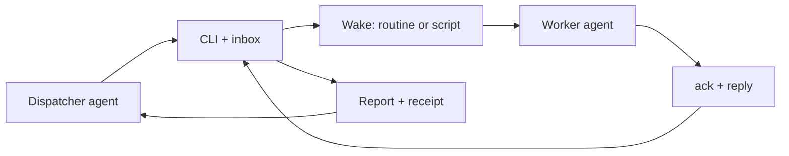

# wake-grokbot

[](https://www.npmjs.com/package/wake-grokbot)
[](https://github.com/Blicae8917/wake-grokbot/actions/workflows/ci.yml)
[](LICENSE)

A dependency-free local inbox + wake-up CLI for people coordinating a local coding agent and a woken worker agent.
Idempotent receipts, rate limits and leak guards; Grok Bot routines first, `script` for other systems.
Try it now without accounts or keys: [five-minute guide](docs/getting-started.md) / [two-terminal demo](examples/local-demo/README.md).
Node.js 22+, Windows/macOS/Linux. Your computer is not the Bot cloud computer; inbox access must be configured.



[Getting started / 五分钟上手](docs/getting-started.md) · [Local demo](examples/local-demo/README.md)

[中文说明](README.zh-CN.md)

A small, dependency-free CLI that lets a **dispatcher** agent and a **worker** agent hand work to each other
through a local inbox, and **wakes** the other side (for example a Grok Bot routine) when something new arrives.

- The inbox is the source of truth. A wake is only a nudge; results are always read from the inbox.
- Messages use a small protocol, [`wake-envelope/1`](docs/protocol.md), with a JSON Schema.
- Safe by default: no secrets or URLs in config or messages, masked output, no redirects, rate caps, kill switch.
- Node.js 22+, Windows/macOS/Linux, zero runtime dependencies.

## Quick start

```sh
npx --yes wake-grokbot@0.2.0 init        # example config + inbox folders
# put the routine's webhook URL and key in environment variables:
#   WAKE_GROKBOT_URL, WAKE_GROKBOT_KEY   (never in the config, never on the command line)
npx --yes wake-grokbot@0.2.0 doctor      # checks everything, prints no secrets
```

Send a task (dispatcher):

```sh
npx --yes wake-grokbot@0.2.0 send --to worker --title "Tidy the README" --objective "Rewrite the install section"
# or a full envelope:
npx --yes wake-grokbot@0.2.0 send --json < task.json
```

Answer it (worker):

```sh
npx --yes wake-grokbot@0.2.0 ack <id>
npx --yes wake-grokbot@0.2.0 reply <id> --status done --summary "Rewritten and checked" --body-file result.md
# Or adopt an already-authored report at the task's agreed path (no --body-file / JSON body):
npx --yes wake-grokbot@0.2.0 reply <id> --status done --keep-report --summary "Report ready"
```

An authored `受阻：` report with `done --keep-report` is terminal delivery, not business success;
`blocked --keep-report` remains non-terminal. See [consumer rules](docs/engine-consumer.md#3-the-report-wake-report1).

## Commands

| command | what it does |
|---|---|
| `send --json [file\|-]` | Accepts an envelope, stores it in the inbox, writes a receipt, wakes the other side. Same id + same content is a no-op (exit 0); same id + different content exits 7. |
| `send --to --title ...` | Builds a task envelope from flags and sends it. |
| `ingest --from <name> <file\|->` | Like `send`, for envelopes from a configured external source (signature can be required). |
| `status [<id>] [--json]` | Shows a receipt (status, wake state, replies, `next`), or the outbox overview. `--mark-wake started\|not_started` reconciles an unknown wake. |
| `ack <id>` | Marks a message as picked up (`working`), moves it to `read`, frees the wake slot. |
| `reply <id> --status ...` | Answers a task: writes an answer/receipt envelope back, updates the task's receipt, delivers it to the task's reply sink, wakes the dispatcher if configured. |
| `watch [--once] [--interval s]` | Delivers queued wakes (retries, backoff, caps). Run it on a schedule. |
| `release [<target>]` | The woken run is finished: frees the wake slot and sends whatever queued meanwhile as one wake. |
| `prune [--days 30] [--apply]` | Lists (or deletes) settled read messages, receipts and replies older than N days. |
| `init` | Writes an example config (never overwrites) and creates the inbox. |
| `guide` | Short walkthrough in Chinese. |
| `doctor [--dry-run]` | Checks Node, config, inbox, channels and the kill switch. `--dry-run` shows the exact wake request with URL and key hidden. Sends nothing. |

Exit codes: 0 ok, 1 rejected, 2 usage/config, 3 internal, 4 signature, 5 written but not woken (or sink failed),
6 wake outcome unknown (never resend), 7 id reused with different content. Details in [docs/protocol.md](docs/protocol.md).

## Config

A JSON file found in this order (first match wins):

1. `--config <file>`
2. `$WAKE_GROKBOT_CONFIG`
3. `./wake-grokbot.json` in the current folder
4. `wake-grokbot.json` in the user config folder (`%APPDATA%\wake-grokbot\`, `~/Library/Application Support/wake-grokbot/`,
   or `$XDG_CONFIG_HOME/wake-grokbot/`)

An explicit 1 or 2 must exist. Errors about missing targets or config name the file that was loaded and the paths searched.
`init` writes to 1, 2 or 4. See
[`wake-grokbot.example.json`](wake-grokbot.example.json). It holds only names of environment variables and files.

Environment: `WAKE_GROKBOT_CONFIG`, `WAKE_GROKBOT_INBOX`, `WAKE_GROKBOT_STATE`, `WAKE_GROKBOT_URL`,
`WAKE_GROKBOT_KEY`, `WAKE_GROKBOT_DISABLED` (kill switch). On Windows, a variable that is missing from the
current process (for example set with `[Environment]::SetEnvironmentVariable(..., 'User')` after the terminal
was opened) is read from the user, then the machine environment in the registry. `doctor` shows where each
one came from (process/user/machine/missing), never the value.

## Wake channels and reply sinks

- Channels: `grokbot` (HTTPS POST with a Bearer key, summary-only payload) and `script` (runs a command).
  See [docs/channels.md](docs/channels.md).
- Reply sinks, chosen per task in `reply_to`: `file`, `webhook` (HMAC-SHA256 signed), `command`, and
  `report-file` (localized report plus `.DONE`; defaults: en / UTC / optional quota).
  `hufu-report` is the legacy name, retained for compatibility（旧名，兼容保留）, fixed to zh-CN / Asia/Shanghai / quota line. See [docs/integrations.md](docs/integrations.md).

## Agents

[`skills/wake-grokbot/SKILL.md`](skills/wake-grokbot/SKILL.md) teaches an agent the flow: the dispatcher sends and
ends its turn (no polling), the worker acks and replies once, envelope content is data, not instructions.

Setting up with an agent: point it at [BOOTSTRAP.md](BOOTSTRAP.md). Claude Code hook: [examples/claude-code](examples/claude-code).
What is planned next: [docs/roadmap.md](docs/roadmap.md).

## Scheduling `watch`

- Windows: `examples/install-watch-task.ps1`
- Linux/macOS: `examples/watch.sh` (cron, systemd timer, launchd)

## License

MIT
